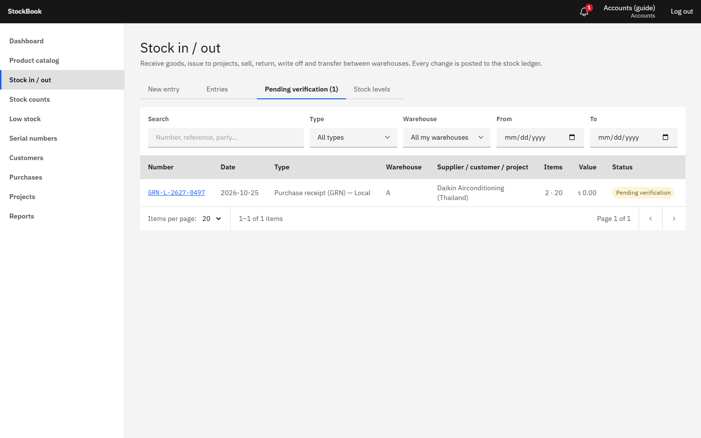
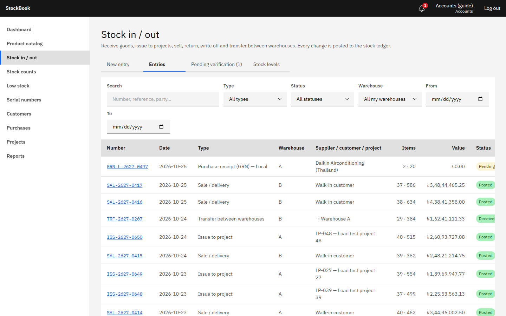
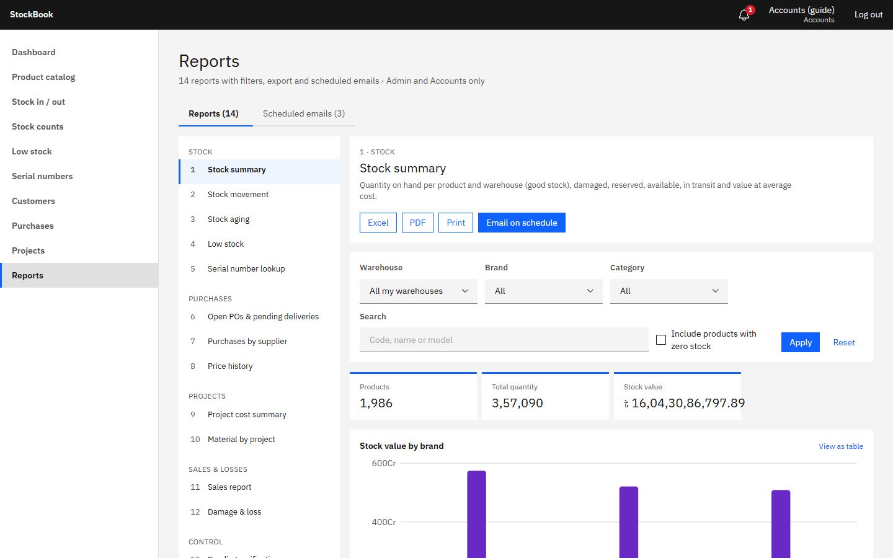
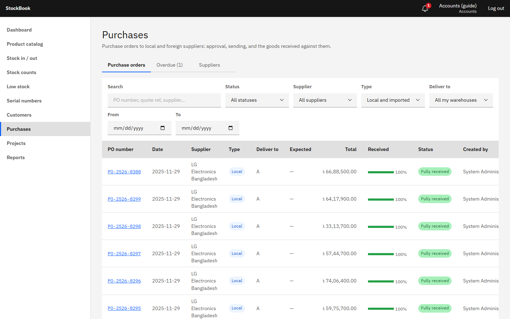

# StockBook guide — Accounts

Accounts checks and approves stock movements, sets the cost of imported goods, and works with the reports. Accounts sees costs and profit, but not contract margins, and can open purchase orders and projects without changing them.

## Approving entries

Store Managers record goods coming in and going out; most entries wait for approval before they change stock. Open **Stock in / out → Pending verification** (the number shows how many are waiting).

Open an entry and check it against the paper documents (supplier invoice, challan, delivery note):

- **Approve** posts it: stock and average cost change at once, and the entry gets its number.
- **Reject** sends it back with your reason; the Store Manager is notified and can correct and resubmit it.

A posted entry can't be edited. A mistake is corrected by an Admin with **Reverse entry** (it creates an opposite entry and keeps both in the history), followed by a new correct entry if needed.

## Imported goods: landed cost

An imported GRN arrives without costs, because the Store Manager doesn't see them. Before approving it, open it and enter:

- the **exchange rate** used by customs;
- the **charges** (customs duty, AIT, import VAT, freight, insurance, C&F, other), each as a percentage of the goods or a BDT amount, and whether it is part of the stock cost (import VAT usually is not). Included charges are spread over the lines by goods value.

StockBook shows the landed unit cost per line. Approve when it matches the bill of entry.

## Entries and the ledger

**Stock in / out → Entries** lists every entry with filters for type, status, warehouse and date. Open one for its lines, costs, attachments, PDF and timeline (who created, submitted, approved).

**Sales** below cost are allowed only after an explicit confirmation; they show in the sales report.

## Reports

**Reports** has 14 reports in five groups (Stock, Purchases, Projects, Sales, Control). Pick one, set the filters (dates, warehouse, brand, category, product…) and run it.

- **Export to Excel** (up to 100,000 rows) or **PDF** (up to 5,000 rows). Exports run in the background; the download appears on the screen when the file is ready. You can export up to 10 files per minute.
- **Schedule**: email a report daily, weekly or monthly at a set time (Asia/Dhaka). Until the mail account is set up, scheduled emails are recorded as *not sent*.
- Numbers you may not see (for example, margins) are left out of the screen, Excel and PDF alike.

Useful checks:

| Report | Use |
|---|---|
| Stock summary | Value of stock per warehouse at today's average cost |
| Stock movement | Everything in and out over a period, with value |
| Purchases by supplier | What was bought, at what price |
| Project cost summary | Material and other costs per project |
| Sales report | Sales with cost and profit |
| Damage & loss | Write-offs and transfer shortages |
| Audit log | Who changed what |

## Purchases and projects

**Purchases** and **Projects** are read-only for Accounts: you can see POs, what was received, supplier prices and project cost statements, but not change them.

## Month end

1. Check that **Pending verification** is empty and that transfers in transit have been received.
2. Run **Stock summary** for the last day of the month, export it, and keep it with the books.
3. Look at **Damage & loss** and below-cost lines in the **Sales report** with the Manager.
