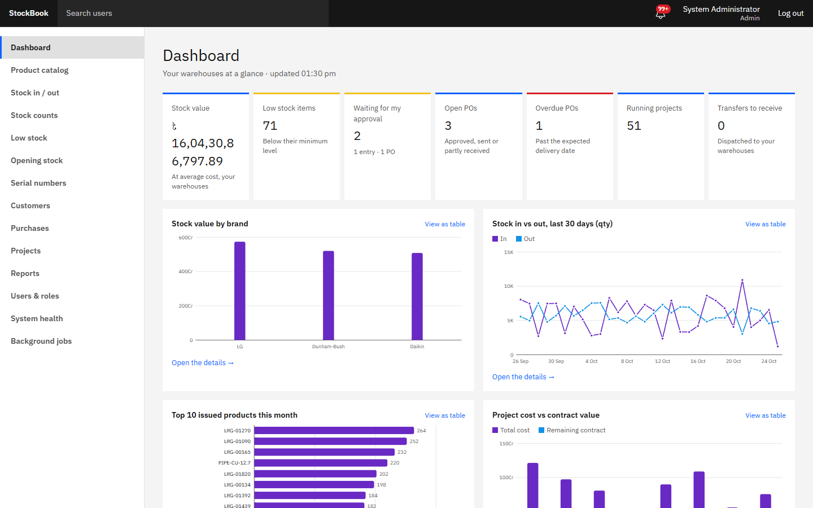
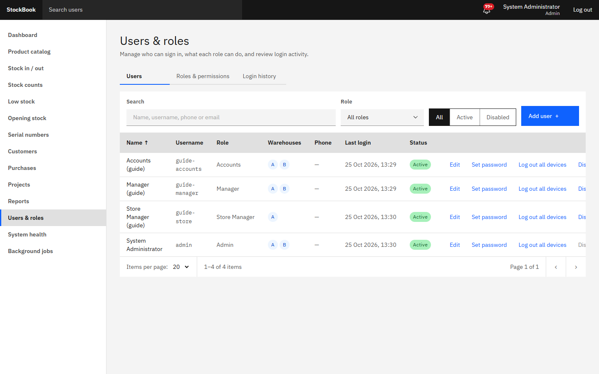
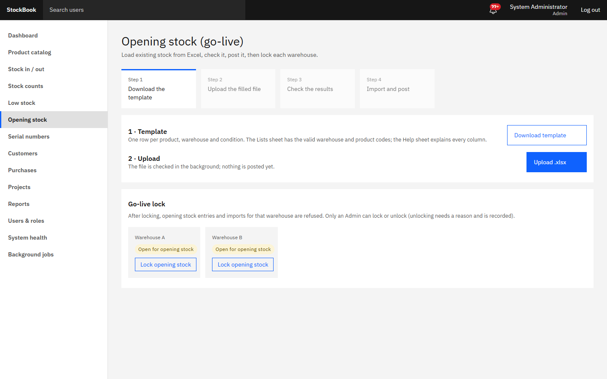
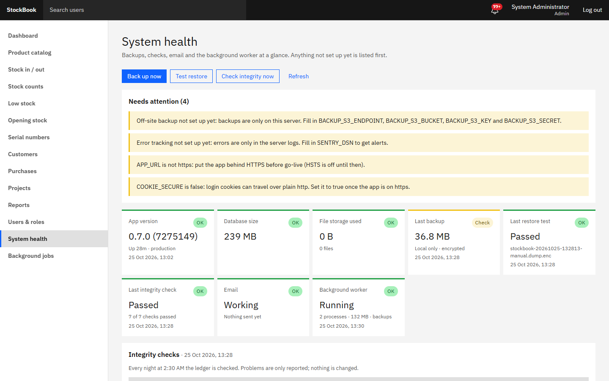
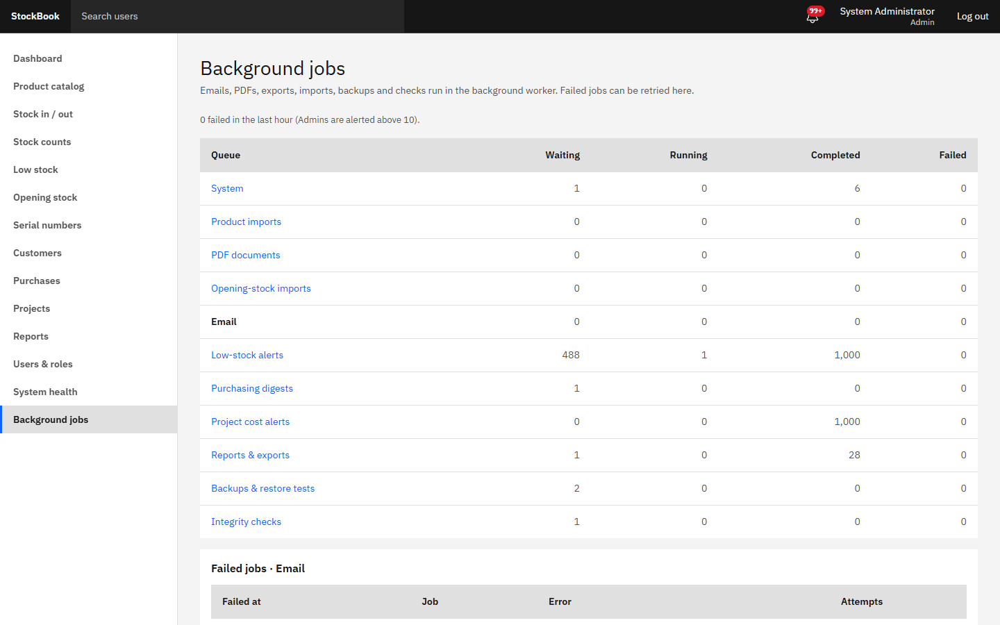

# StockBook guide — Admin

The Admin role can do everything, and it is the only role that manages users, approves purchase orders and sees the system pages. There should be one or two Admins, each with their own account.

## Users and roles

**Users & roles** (left menu).

- **New user**: name, username, role, the warehouses the person works in, and a starting password (at least 10 characters, not a common one). Give the password to the person in private. They can't change it themselves, so set a new one for them when needed (**Set password**).
- **Warehouses** limit everything the user sees: a Store Manager for Warehouse A never sees Warehouse B's stock, entries or serial numbers.
- **Disable** a user who leaves. Their history stays, and they are signed out at once.
- **Log out all devices** ends every session of that user (web and phone) — use it when a phone is lost or a password may be known to someone else.
- **Roles & permissions**: the four standard roles can be edited, except Admin. To make a variant, use **New role → Start with permissions of** and change the permissions per module (None / View / Create / Approve / Full) and the cost flags (see cost, profit, margin). Changes apply immediately.

Web sessions end after 30 minutes without activity. Five wrong passwords in 15 minutes lock the account until an Admin sets a new password.

## Purchase orders

Managers create purchase orders and submit them. Open **Purchases**, filter by *Submitted*, open a PO and **Approve** or **Reject** (with a reason). After approval you can email it to the supplier, mark it sent, amend it, and close or cancel it later. Store Managers receive goods against approved POs.

## Correcting a posted entry

Posted entries are never edited. Open the entry and use **Reverse entry** with a reason: StockBook creates a reversal that undoes the stock and cost exactly, and keeps both in the history. Then the Store Manager records the entry again correctly. A reversal is refused if stock would go negative, its serial numbers have moved on, or later entries depend on it — reverse those first.

## Opening stock (once, at go-live)

**Opening stock**: download the template, fill in one sheet per warehouse, import it and fix any row the import reports, then **lock** opening stock for that warehouse. After the lock, stock changes only through entries. See [go-live.md](../go-live.md).

## System health

**System health** shows whether StockBook is safe and running:

| Tile | Good when |
|---|---|
| Version | Shows the version and commit you expect |
| Database / storage | Sizes grow slowly; no error |
| Backup | Last night's backup is there, with size and place (*this server* or *this server + off-site*) |
| Restore test | Passed in the last month |
| Integrity | Last night's check passed |
| Email | *Working*, or *Not set up yet* until the mail account exists |
| Worker | Heartbeat a few seconds old |

**Warnings** at the top list what needs attention, for example "Email is not set up yet" or "Off-site backup not set up yet: backups are only on this server". They disappear when the setting is made.

Buttons: **Back up now** (before a risky change), **Test restore** (proves the newest backup can be restored), **Check integrity now** (compares stock with the ledger). Each runs in the background — press **Refresh** after a minute. You also get a notification when a backup, restore test or integrity check fails.

**If the integrity check fails:** the check only reports and changes nothing. Open the failing check to see example products or documents, and decide with Accounts how to correct it (normally an adjustment entry with a reason). Ask the developer if the cause is not clear.

## Background jobs

**Background jobs** lists the work the worker does (emails, imports, PDFs, exports, schedules, backups) per queue, with counts and the failed jobs.

A failed job shows its error and how often it was tried. **Retry** puts it back after the cause is fixed (for example, after the mail settings are corrected). If many jobs fail within an hour, Admins get a notification.

## Audit log and login history

**Reports → Audit log** records who changed what and when, with before and after values. **Users & roles → Login history** shows sign-ins, wrong passwords and lockouts. Neither can be edited or deleted.

## Daily and monthly checks

| When | Check |
|---|---|
| Every morning | System health: backup from last night, integrity passed, no warnings you don't expect |
| Every morning | Background jobs: no failed jobs |
| Weekly | Disabled users are really gone; nobody has more warehouses or permissions than needed |
| Monthly | The restore test of the 1st passed; off-site copy present (once set up) |
