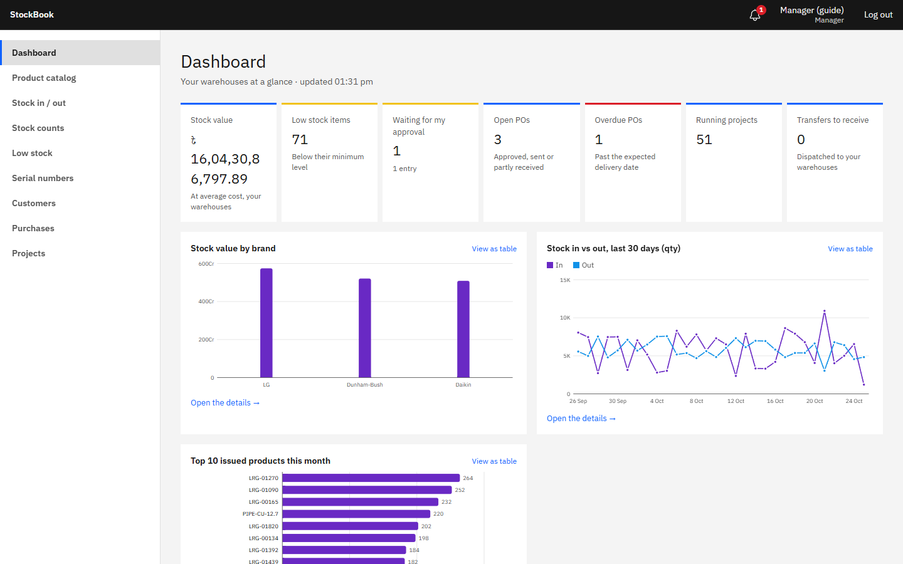
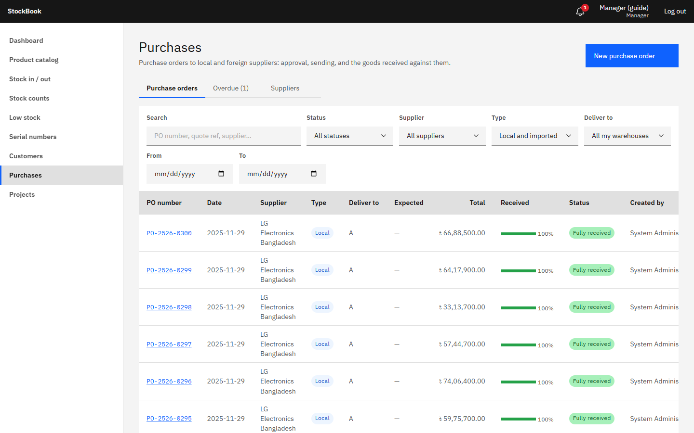
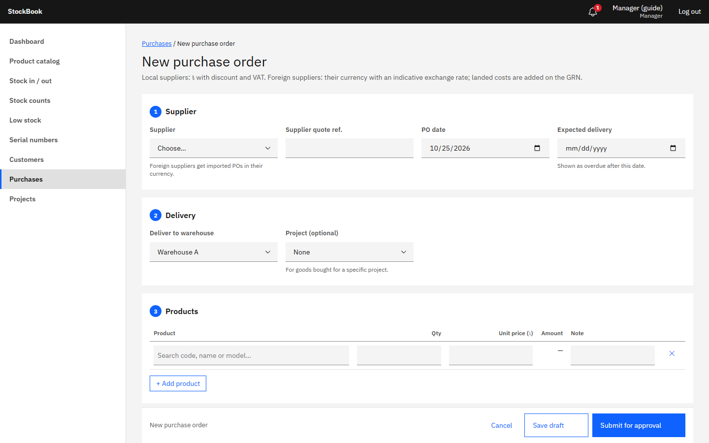
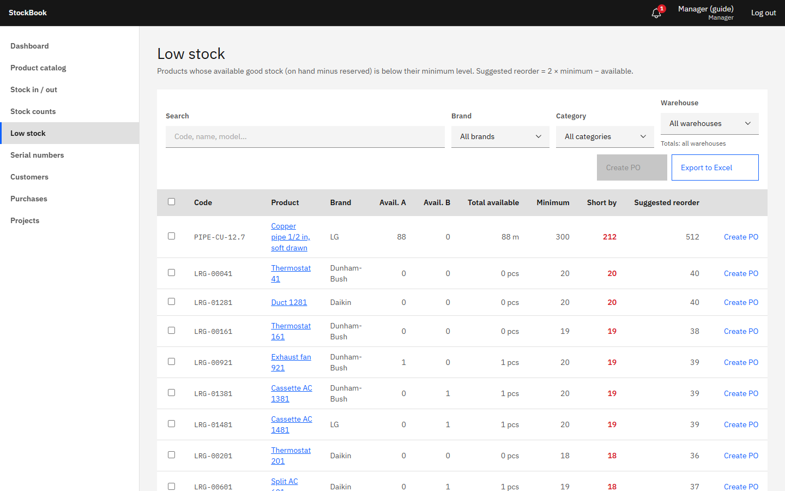
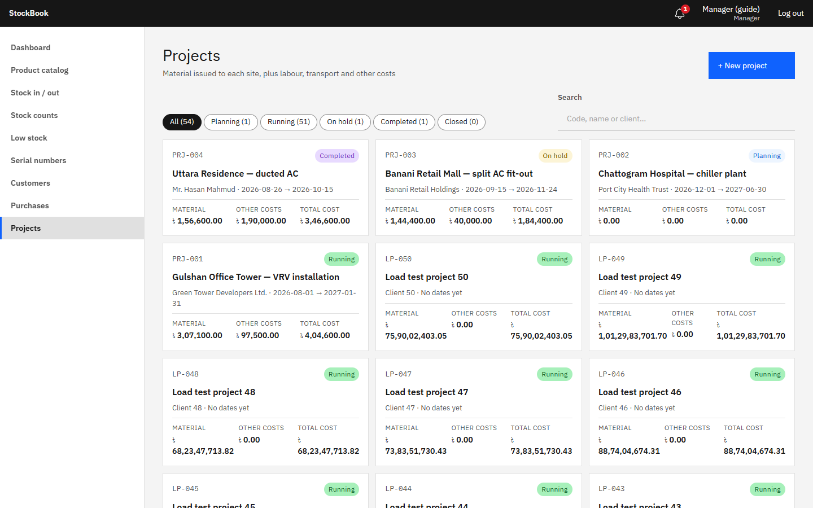

# StockBook guide — Manager

The Manager runs operations: approves stock entries, raises purchase orders, manages projects and keeps an eye on stock levels. The Manager sees costs, but not profit or margins, and has no Reports menu (the dashboard gives the overview).

## Dashboard

The dashboard shows stock value, low-stock items, open and overdue purchase orders, running projects, transfers in transit, and your own items waiting for approval. Click a tile to open the list behind it.

## Approving stock entries

**Stock in / out → Pending verification** lists what Store Managers have submitted. Open each one, compare it with the documents, then **Approve** (it posts at once) or **Reject** with a reason. Stock count variances are approved from **Stock counts** in the same way. Posted entries are never edited: an Admin corrects a mistake with **Reverse entry**.

## Purchase orders

**Purchases** lists all POs by status. Suppliers are on the same page.

1. **New purchase order**: supplier, deliver-to warehouse, expected date, lines (product, quantity, unit price), and terms. **Save draft** or **Submit for approval**.
2. An Admin approves it; you get a notification. The approved PO can then be emailed or printed for the supplier.
3. When the goods arrive, the Store Manager makes a GRN *against the PO*. Prices come from the PO, and the PO shows what is received and what is still due.
4. Partly delivered POs stay open until everything has arrived or an Admin closes them.

**From low stock:** **Low stock** lists products under their minimum level per warehouse. Select products and use **Create PO** to start a draft PO with the suggested quantities.

## Projects

**Projects** holds each installation job: client, site, contract value (only shown to those who may see margins), default warehouse and status.

- Materials reach a project only through **Issue to project** entries made by the Store Manager; returns from site go back the same way. You don't type material costs by hand.
- Add other costs (labour, transport, subcontractors…) under **Other costs** on the project, with receipts attached.
- The cost statement (also as **Cost statement PDF**) totals materials (at the cost when issued, less returns) and the other costs.
- Statuses: Planning → Running → Completed → Closed, with On hold in between. Materials can be issued only while Planning or Running; returns are accepted until the project is Closed. Reopening and closing need projects Full (Admin).

## Stock counts

**Stock counts → New stock count**: choose the warehouse and what to count (all products, a catalog, a category or a list). The Store Manager prints the count sheet, counts and submits. You review the variance (quantity and value), ask for a recount when needed, and approve it. The approved count posts the adjustments.

## Customers

**Customers** keeps the customer list used on sales entries (name, phone, address).
