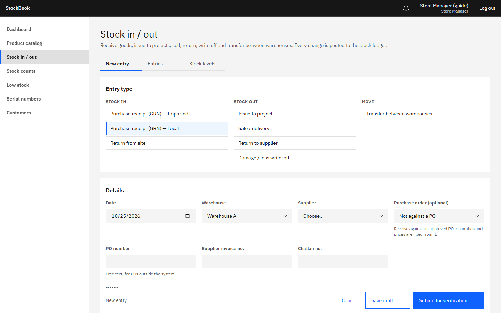
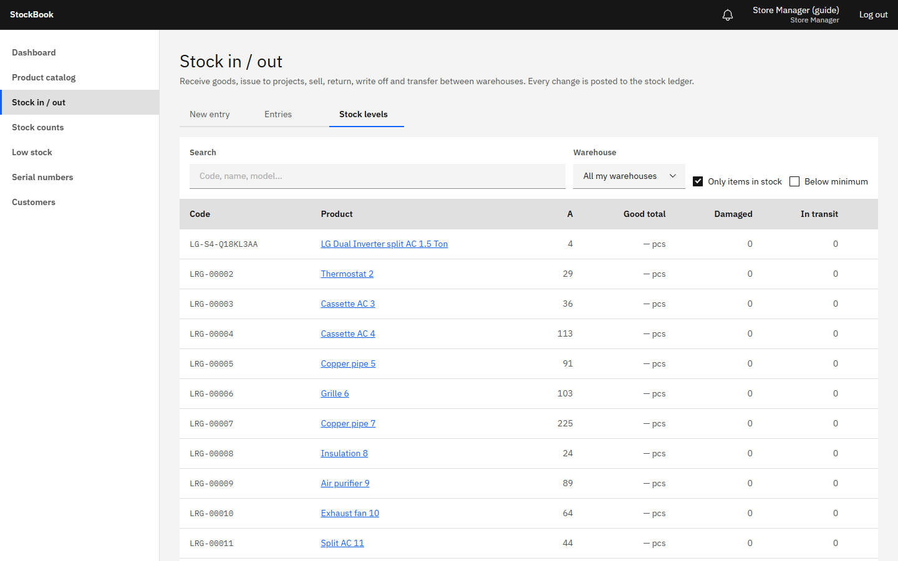
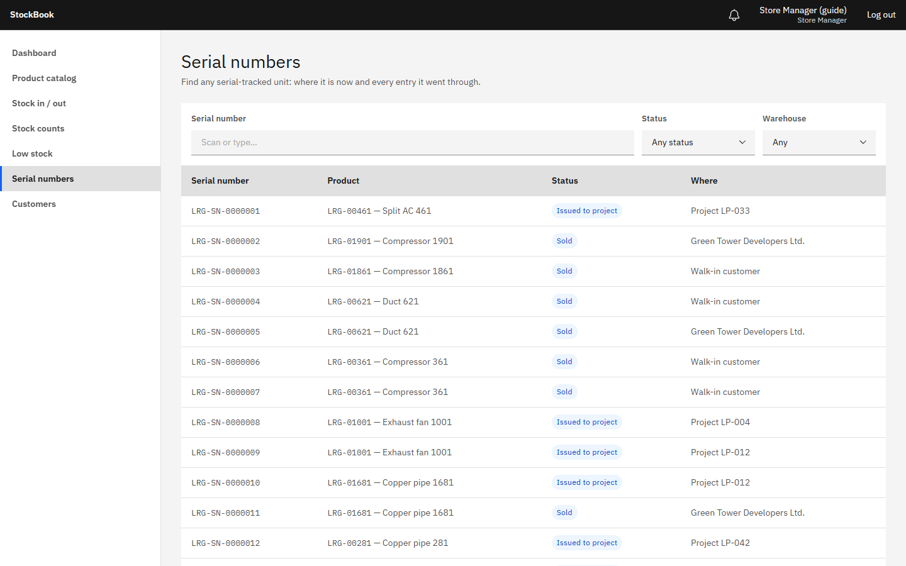
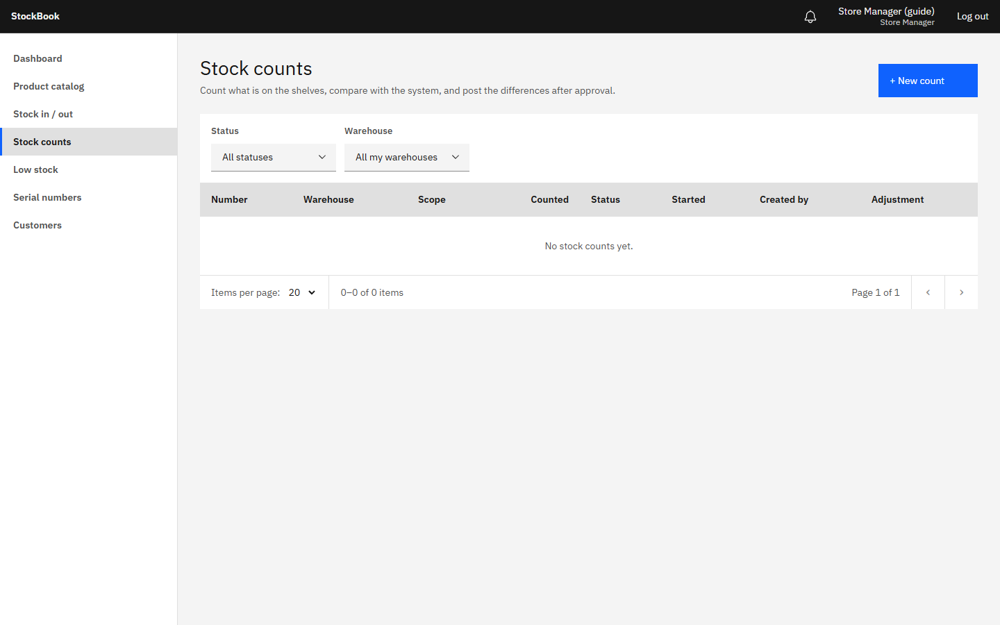

# StockBook guide — Store Manager

The Store Manager records everything that physically comes into or leaves their warehouse, at the moment it happens. You see only your own warehouse(s) and no costs or prices (except selling prices you type on a sale). Most entries go to Accounts or the Manager for verification before stock changes.

## Recording an entry

**Stock in / out → New entry**, then choose the type:

| Type | Use it when |
|---|---|
| Purchase receipt (GRN) — Local | Goods arrive from a local supplier. Choose the purchase order if there is one: the lines and remaining quantities are filled in for you. |
| Purchase receipt (GRN) — Imported | Imported goods arrive. Enter quantities, serial numbers and the document numbers (LC, bill of entry); Accounts adds the costs. |
| Issue to project | Material leaves for a site. Choose the project; it then counts as that project's cost. |
| Return from site | Unused material comes back from a project. |
| Sale / delivery | Goods are sold or delivered to a customer. |
| Return to supplier | Goods go back to the supplier. |
| Damage / loss write-off | Goods are damaged, lost or stolen. Write what happened in the reason field. |
| Transfer between warehouses | Goods move to the other warehouse (vehicle and challan number). |

For each line: the product (search by code, name or barcode), the quantity, and — for serial-tracked products — **one serial number per unit** (type or scan them). StockBook refuses quantities you don't have, and serial numbers that are not in your warehouse.

Then:
- **Save draft** keeps it to finish later (nothing changes yet);
- **Submit for verification** sends it to Accounts / the Manager. You get a notification when it is approved (posted) or rejected (with the reason). Correct a rejected entry and submit it again.

Attach photos or scans of the supplier challan or invoice to the entry. Print the GRN, challan or note from the entry once it is posted (the PDF never shows costs to you).

## Transfers

1. The sending warehouse records **Transfer between warehouses**; when it is approved, the goods are *in transit*.
2. The receiving Store Manager opens the transfer (**Entries**, status *Dispatched*), counts what arrived and records the quantities received.
3. If something is missing, the shortage is recorded with the transfer and shows on the damage & loss report — don't hide it.

## Stock levels and serial numbers

**Stock levels** shows what is on hand, reserved (in entries waiting for approval) and available in your warehouse; open a product for its stock card (every movement).

**Serial numbers** finds any serial: where it is, its status (in stock, issued, sold, in transit…) and its history.

## Stock counts

When a count is started for your warehouse it appears under **Stock counts**:

1. **Print count sheet** (it doesn't show the system quantity, so the count is blind).
2. Count the shelves and enter the counted quantities (and serial numbers) in StockBook.
3. Submit. The Manager reviews the differences and may ask for a recount. Stock is adjusted only when the count is approved.

Avoid moving stock in the area being counted until you submit.

## Good habits

- Record goods **when they move**, not at the end of the day.
- One entry per document (one GRN per supplier challan, one challan per delivery).
- Never "fix" stock with a different entry type: if a posted entry was wrong, tell the Manager; an Admin reverses it and you record it again correctly.
